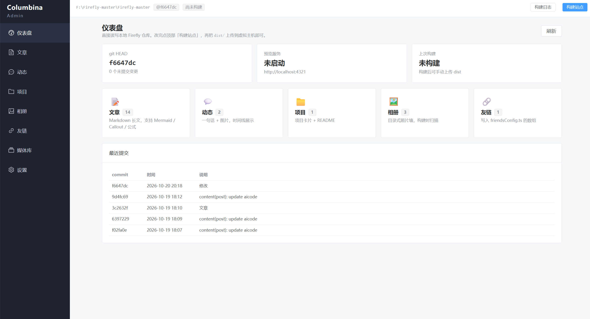

<p align="center">
  
</p>

<h1 align="center">Columbina Admin</h1>

<p align="center">给 <a href="https://github.com/CuteLeaf/Firefly">Firefly</a> 博客用的本地后台管理工具</p>

---

不用改博客主题，不用装数据库。打开浏览器就能写文章、发动态、传照片、管相册和友链，改完在本地构建，把 `dist` 上传到服务器即可。

## 能做什么

- **文章 / 动态 / 项目 / 相册 / 友链** 的增删改查
- **实时预览** —— 直接调用博客自己的 `astro dev`，看到的就是真实效果
- **图片上传** —— 自动压缩、转 webp、去除 EXIF、相同图片自动复用
- 支持 Mermaid、提示框、数学公式等 Firefly 的 Markdown 写法
- 每次保存自动 `git commit`，改坏了随时回滚



## 准备工作

- Node.js 20 或更高
- pnpm（`npm install -g pnpm` 或 `corepack enable`）
- 一个已经装好依赖、能正常构建的 Firefly 博客仓库

## 安装

```bash
git clone https://github.com/apiaoapiao/columbina-admin.git
cd columbina-admin
pnpm install
```

复制配置文件：

```bash
copy admin.config.example.json admin.config.json      # Windows
cp  admin.config.example.json admin.config.json       # macOS / Linux
```

打开 `admin.config.json`，把 `repoPath` 改成你博客仓库的路径：

```json
{
  "repoPath": "F:/Firefly-master/Firefly-master"
}
```

## 启动

Windows 直接双击 `start-admin.bat`，或者：

```bash
pnpm start
```

浏览器会自动打开 `http://127.0.0.1:4310`。

> 之后想跳过编译直接启动，用 `pnpm start:fast`。

## 怎么用

### 写文章

侧边栏「文章」→ 右上角「新建」。填写标题、日期、分类、标签，正文支持 Markdown。

写好点「保存并预览」，会启动博客预览并把页面显示出来；不满意继续改，满意就点「保存」。

### 发布上线

点顶部「构建站点」，等日志跑完，再点「设置 → 打开 dist 目录」，把 `dist` 里的文件上传到虚拟主机（建议打包成 zip 传，比逐个文件快）。

### 发动态

侧边栏「动态」→「新建」，写一两句话，可以传图、加位置、置顶。动态不需要标题。

### 管理相册

「相册」→「新建」，先填**相册 ID**（小写字母和数字，比如 `japan-2025`，它会成为 URL 的一部分，创建后不能改），再填名称和描述。

保存后进入相册详情页，可以批量上传照片，点任意一张可以「设为封面」。

### 插入图片

在正文编辑器里**直接粘贴或拖拽图片**，会自动上传并插入到光标位置。

### 友链

「友链」→「新建」，填站点名、头像、地址、描述和权重。不想显示某个友链时把「启用」关掉，不用删除。

## 配置说明

`admin.config.json` 里常改的几个：

| 字段 | 默认 | 说明 |
|---|---|---|
| `repoPath` | — | 博客仓库路径，必填 |
| `port` | 4310 | 后台端口 |
| `gitCommit` | true | 保存后自动 git 提交 |

改完需要重启后台。

## 文档

配置项全表、实现原理、常见问题，见 [`docs/PROJECT.md`](docs/PROJECT.md)。

## License

[MIT](LICENSE)
